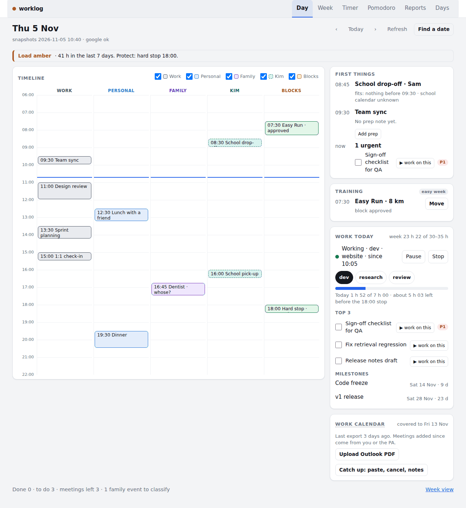
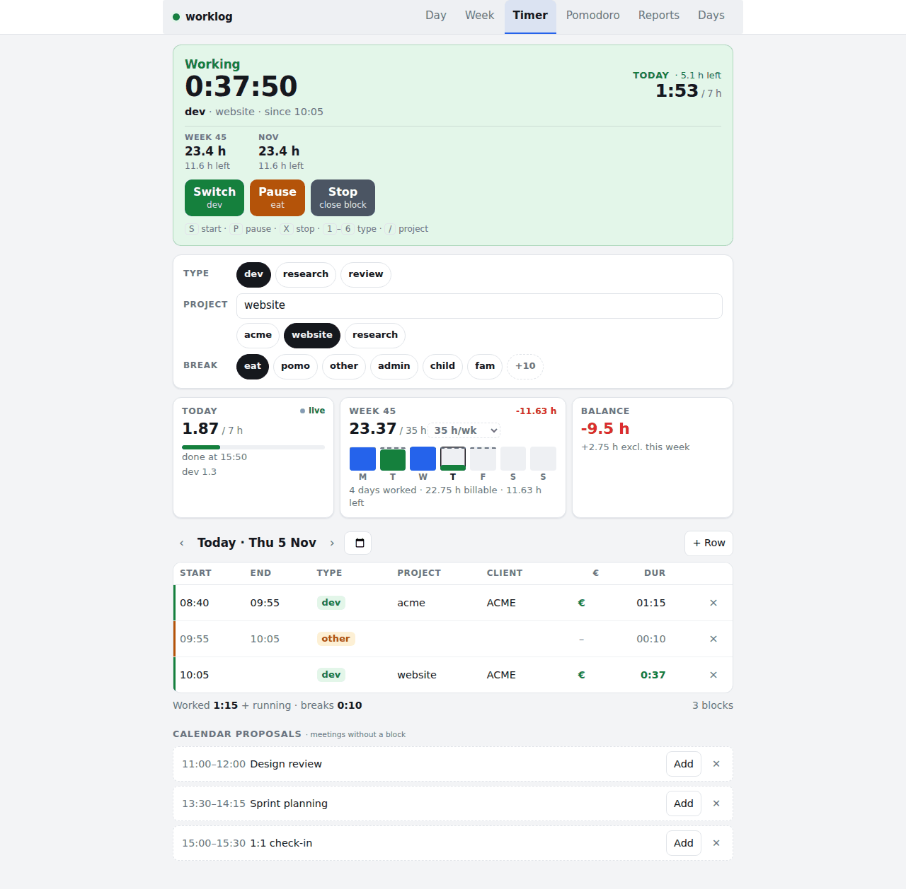
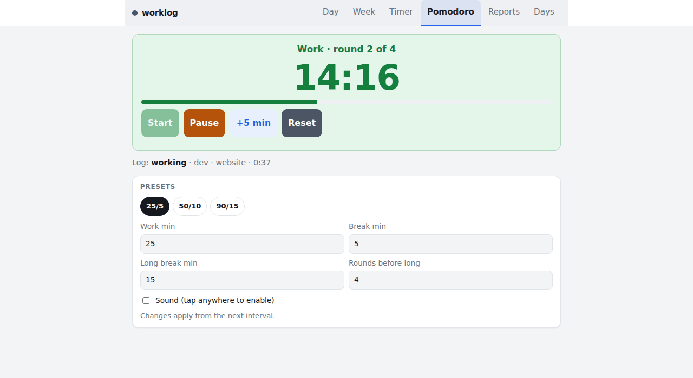
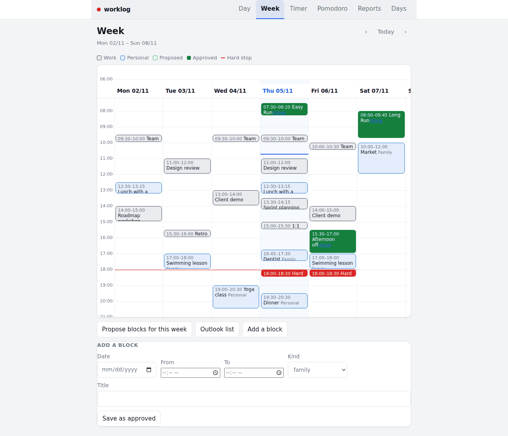
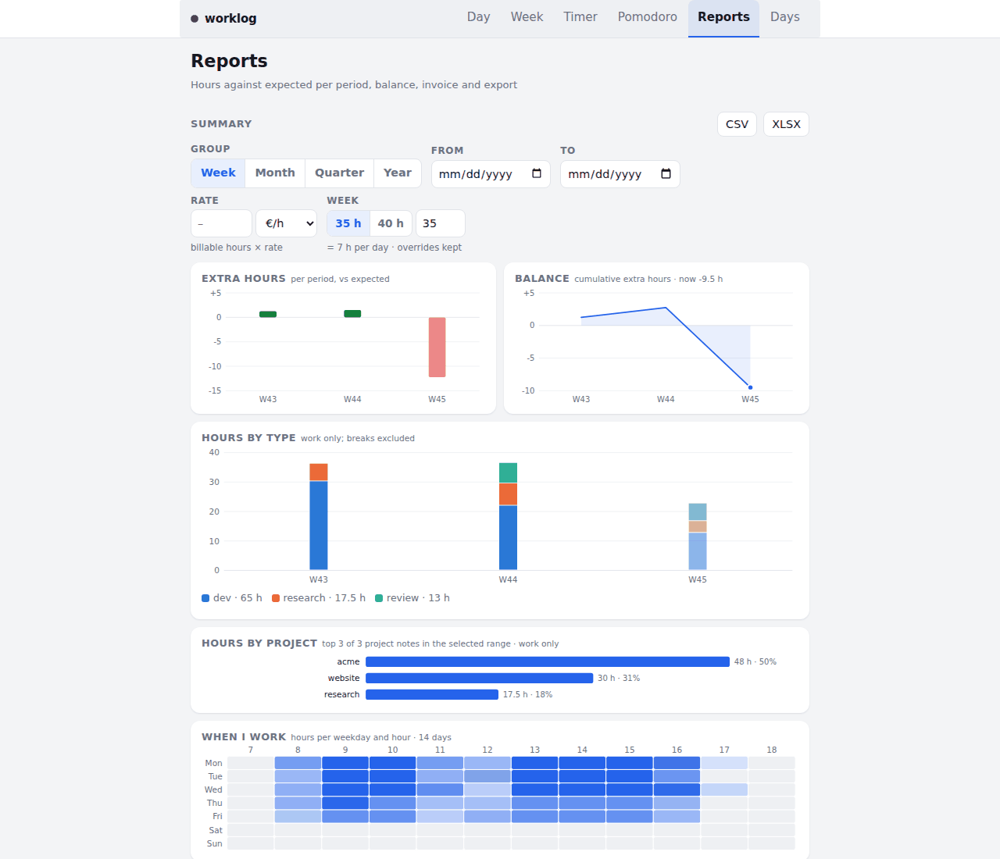
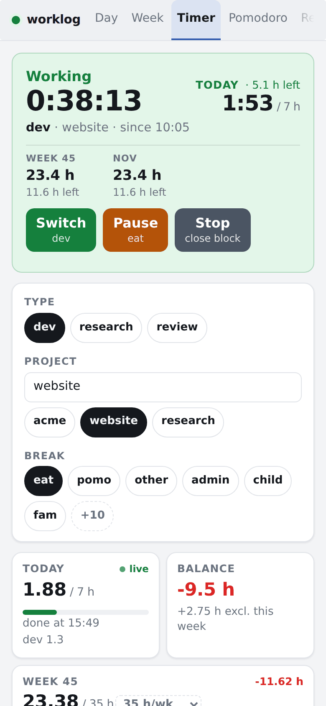
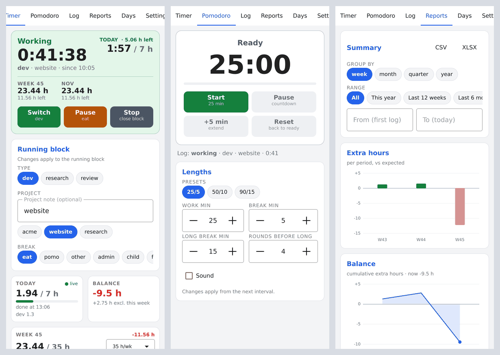

# worklog

A self-hosted work/break timer with reports, plus an optional day planner that protects
your evenings and training time.

- **Timer** (`/timer`): start, pause and stop work blocks; switch type or project; the day's
  blocks with gaps; meeting proposals from a work-calendar database.
- **Pomodoro**: a per-device countdown that *offers* to pause or resume the timer at each
  interval, never on its own.
- **Reports**: summaries per week, month, quarter and year, charts, weekly stats, an invoice
  view, XLSX/CSV import and export.
- **Days**: expected and sick hours per day, with holidays from a cache file.
- **Day dashboard** (`/`) and **Week** (`/week`), optional: one timeline of work meetings,
  personal and family calendars, care duties (school runs) and protected blocks; a capacity
  gate (green/amber/red over rolling weeks of hours, wellness and training); "where does this
  fit" and "move this" helpers.

Clients that talk to the same JSON API:

- a Qt Quick app for desktop and Android (`qt/`)
- a Garmin Connect IQ widget with a glance (`garmin/`, see [garmin/README.md](garmin/README.md))

Everything personal (people, calendars, timezone, holiday scopes, paths, credentials) is
configuration. Nothing is hardcoded to one household or one server.

## Screenshots



All screenshots show synthetic demo data (made-up projects, meetings and people).

| | |
|---|---|
|  **Timer** (`/timer`): the running block, today's blocks and calendar proposals. |  **Pomodoro**: a per-device countdown that offers to pause the timer. |
|  **Week** (`/week`): meetings, approved and proposed protected blocks, the hard stop and the capacity gate. |  **Reports**: hours against expected, balance, by type and project. |
|  **Phone**: the timer page at 390 px wide. |  **Qt app** (`qt/`): timer, pomodoro and reports, rendered offscreen on the desktop. |

## Quick start

You need Python 3.12 or newer and [uv](https://docs.astral.sh/uv/).

```sh
git clone https://github.com/alexgoldhoorn/worklog.git && cd worklog
uv sync
mkdir -p data                      # the app does not create the directory itself
export WORKLOG_DB=./data/worklog.db TZ=Europe/Amsterdam
uv run uvicorn worklog.web.app:factory --factory --port 8503
```

Open <http://127.0.0.1:8503/timer>. The database is created and migrated on first start.
The app is created by `factory()` (there is no module-level `app`), which reads its
settings from the environment through `worklog/config.py`. `TZ` decides what "today" is;
without it the server uses UTC.

The server listens on `127.0.0.1` by default. To reach it from other devices add
`--host 0.0.0.0`, and set a login first (below).

## Docker

```sh
docker build -t worklog .
mkdir -p data && sudo chown 1000:1000 data     # the container runs as uid 1000
docker run -d --name worklog -p 8503:8000 -v "$PWD/data:/data" \
  -e WORKLOG_DB=/data/worklog.db -e TZ=Europe/Amsterdam worklog
```

With compose, copy [examples/worklog.env.example](examples/worklog.env.example) to
`examples/worklog.env`, edit it, then:

```sh
cd examples && mkdir -p data && docker compose up -d --build
```

The image listens on port 8000. `GET /healthz` answers `{"ok": true}` and never needs a
login. The compose file lists the optional mounts for the Day and Week pages, commented out.

Error reporting is optional: set `WORKLOG_SENTRY_DSN` to a Sentry (or Sentry-compatible) DSN
and unhandled exceptions are reported; expected 4xx errors are not. Unset, `sentry_sdk` is
never imported.

## Authentication

By default there is no login. To turn one on, hash a password and set both variables:

```sh
uv run python -m worklog.auth          # asks for a password, prints a pbkdf2_sha256 hash
export WORKLOG_AUTH_USER=me WORKLOG_AUTH_PASSWORD_HASH='pbkdf2_sha256:...'
```

Every page and API route then needs HTTP Basic credentials, except `/healthz`. Without them
the server answers `401 {"error": "login required"}`. If only one of the two variables is
set, the server refuses to start; with neither it starts open and logs a warning. It is plain HTTP Basic, so put the app behind HTTPS (a reverse
proxy) when it leaves your LAN. Scripts and clients pass the same user and password, for
example `curl -u me:secret http://127.0.0.1:8503/api/status`.

All variables are listed in [docs/configuration.md](docs/configuration.md). The HTTP API is
described in [docs/api.md](docs/api.md).

## Upgrading

```sh
git pull
uv sync                                  # or: docker compose up -d --build
```

Restart the server. The timer database upgrades itself on start (a numbered migration list in
`worklog/db.py`, tracked in SQLite's `user_version`), and the planner store
(`balance.db`) adds missing tables when opened. Migrations only go forward, so take a copy
before upgrading:

```sh
sqlite3 data/worklog.db ".backup data/worklog-$(date +%F).db"
```

Use `.backup`, not `cp`: the database runs in WAL mode, so a plain copy of the main file can
miss recent writes. The CSV/XLSX export (`/api/export.xlsx`) is a second, human-readable
backup.

## The day planner (optional)

The timer works on its own. The Day and Week pages add three things around it:

1. **Household rules**: copy [day/rules.example.json](day/rules.example.json), edit the
   people, calendar names, care duties and timezone, and point `DAY_RULES` at it.
2. **Inputs**: JSON snapshots and data files in a state directory (calendar events, Todoist
   goals, a training plan, wellness). Formats are in [docs/configuration.md](docs/configuration.md).
3. **Host jobs** that fill the state directory and push approved blocks to Google Calendar:

   ```sh
   uv run python -m balance.jobs.gate      # daily: the capacity verdict
   uv run python -m balance.jobs.sync      # every 2 min: snapshots, write queue, mirror, nudge
   uv run python -m balance.jobs.propose   # weekly: next week's run and hard-stop blocks
   ```

   They run without any integration and report what is missing. Calendar fetching, Google
   OAuth and the school calendar come from an optional host library; see
   [docs/host-integration.md](docs/host-integration.md).

The container never holds credentials: it only reads the state directory and writes its
requests (complete a task, create a calendar event, annotate a meeting) to a queue in
`balance.db`, which the sync job drains. Each job takes `--dry-run` to show what it would
do. The jobs find their paths through `WORKLOG_STATE_ROOT` and `~/.config/worklog/host.env`;
see [docs/configuration.md](docs/configuration.md).

## Tests

```sh
uv run pytest -q
```

The suite runs against the example household (`day/rules.example.json`). The Excel parity
test is skipped unless `WORKLOG_EXCEL` points at a spreadsheet to compare against.

## Packages

- `worklog/`: timer, blocks, reports, the web app and its JSON API (`worklog/web/api.py`).
- `balance/`: capacity gate, protection blocks, snapshots, the Google mirror, the hard-stop
  nudge and the job runners (`balance/jobs/`).
- `day/`: the Day dashboard model, the slot engine behind "find" and "move", and its API.

## Contributing

Install the pre-commit hook once: `scripts/git-hooks/install.sh`. It refuses data files and
local config, checks staged text against your own deny list
(`~/.config/worklog/deny-patterns.txt`, one regex per line, never committed) and runs the
tests.

## License

MIT, see [LICENSE](LICENSE).
